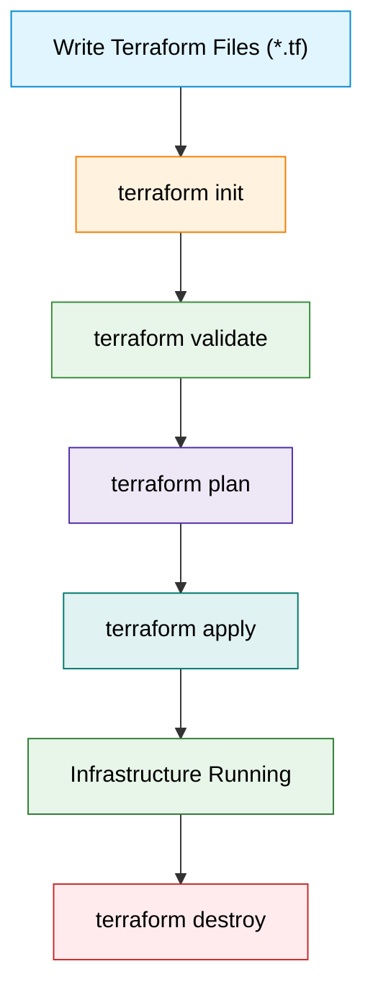

# 🏗️ Terraform Project Structure & Syntax Guide

Welcome to the **Terraform Syntax & Project Structure Guide**! This document provides a complete breakdown of how a production-ready Terraform project is organized, what each file is responsible for, the generic syntax rules, and hands-on real-world examples for each component.

---

## 📑 Table of Contents
1. [Overview: How Terraform Evaluates Files](#1-overview-how-terraform-evaluates-files)
2. [Standard Project Structure](#2-standard-project-structure)
3. [File-by-File Breakdown with Syntax & Examples](#3-file-by-file-breakdown)
   - [providers.tf (Provider & Version Setup)](#31-providerstf)
   - [backend.tf (Remote State Management)](#32-backendtf)
   - [variables.tf (Input Variables Definition)](#33-variablestf)
   - [terraform.tfvars (Variable Values Assignment)](#34-terraformtfvars)
   - [locals.tf (Computed / Reusable Expressions)](#35-localstf)
   - [data.tf (Data Sources - Read Existing Infrastructure)](#36-datatf)
   - [main.tf (Core Infrastructure Resources)](#37-maintf)
   - [outputs.tf (Exported Values & Endpoints)](#38-outputstf)
   - [modules/ (Reusable Infrastructure Blocks)](#39-modules-reusable-infrastructure)
4. [Essential Git & State Files](#4-essential-git--state-files)
5. [Terraform CLI Command Lifecycle](#5-terraform-cli-command-lifecycle)

---

## 1. Overview: How Terraform Evaluates Files

> [!NOTE]
> In Terraform, **all `.tf` files in the same directory belong to the same root module**. Terraform merges all `.tf` files together in memory during execution. The split into `main.tf`, `variables.tf`, `providers.tf`, etc., is a **best practice convention** for clean architecture and team collaboration.

---

## 2. Standard Project Structure

A clean, production-grade single-environment project is structured as follows:

```text
my-terraform-project/
├── .gitignore               # Ignores local state, .terraform directory, and secrets
├── .terraform.lock.hcl      # Locks exact provider versions (commit to Git)
├── backend.tf               # Configures remote state storage (e.g., AWS S3 + DynamoDB)
├── providers.tf             # Declares required plugins/providers (e.g., AWS, Azure, GCP)
├── variables.tf             # Declares input variables with types and descriptions
├── terraform.tfvars         # Assigns actual values to input variables (DO NOT commit secrets)
├── locals.tf                # Defines computed local constants and common tags
├── data.tf                  # Fetches data from existing cloud infrastructure (AMIs, VPCs)
├── main.tf                  # Defines the main cloud resources (EC2, VPC, S3, etc.)
├── outputs.tf               # Exposes outputs (IP addresses, resource IDs, ARNs)
└── modules/                 # (Optional) Reusable child modules
    ├── vpc/
    │   ├── main.tf
    │   ├── variables.tf
    │   └── outputs.tf
    └── ec2/
        ├── main.tf
        ├── variables.tf
        └── outputs.tf
```

---

## 3. File-by-File Breakdown

---

### 3.1 `providers.tf`
**Purpose**: Tells Terraform which cloud providers (AWS, Azure, GCP, Kubernetes) or plugins are needed, where to download them from (registry), their version constraints, and provider-specific configurations (like AWS region or default tags).

#### 🔹 Generic Syntax Blueprint
```hcl
terraform {
  required_version = ">= <MINIMUM_TERRAFORM_VERSION>"

  required_providers {
    <PROVIDER_LOCAL_NAME> = {
      source  = "<REGISTRY_NAMESPACE>/<PROVIDER_NAME>"
      version = "<VERSION_CONSTRAINT>"
    }
  }
}

provider "<PROVIDER_LOCAL_NAME>" {
  region  = <REGION_VALUE_OR_VARIABLE>
  profile = "<OPTIONAL_CLI_PROFILE>"

  default_tags {
    tags = {
      <TAG_KEY> = <TAG_VALUE>
    }
  }
}
```

#### 💡 Working Example (`providers.tf`)
```hcl
terraform {
  required_version = ">= 1.5.0"

  required_providers {
    aws = {
      source  = "hashicorp/aws"
      version = "~> 5.0"
    }
    random = {
      source  = "hashicorp/random"
      version = "~> 3.5"
    }
  }
}

provider "aws" {
  region = var.aws_region

  default_tags {
    tags = {
      Environment = var.environment
      ManagedBy   = "Terraform"
      Project     = "CloudInfrastructure"
    }
  }
}
```

---

### 3.2 `backend.tf`
**Purpose**: Configures where Terraform stores its **State File** (`terraform.tfstate`). Storing state remotely (e.g. AWS S3) allows team collaboration and state locking (using DynamoDB) prevents concurrent applies from corrupting the state.

#### 🔹 Generic Syntax Blueprint
```hcl
terraform {
  backend "<BACKEND_TYPE>" {
    bucket         = "<STATE_BUCKET_NAME>"
    key            = "<PATH_TO_STATE_FILE>/terraform.tfstate"
    region         = "<BUCKET_REGION>"
    dynamodb_table = "<LOCK_TABLE_NAME>"
    encrypt        = true
  }
}
```

#### 💡 Working Example (`backend.tf`)
```hcl
terraform {
  backend "s3" {
    bucket         = "mycompany-terraform-states-bucket"
    key            = "dev/network-app/terraform.tfstate"
    region         = "us-east-1"
    dynamodb_table = "terraform-state-locks"
    encrypt        = true
  }
}
```

---

### 3.3 `variables.tf`
**Purpose**: Defines the configurable parameters (inputs) for your infrastructure. Variables make your Terraform code reusable across different environments (`dev`, `staging`, `prod`) without modifying resource code.

#### 🔹 Generic Syntax Blueprint
```hcl
variable "<VARIABLE_NAME>" {
  type        = <DATA_TYPE>         # string, number, bool, list(string), map(string), object({...})
  description = "<EXPLANATION_OF_WHAT_THIS_VARIABLE_IS_FOR>"
  default     = <DEFAULT_VALUE>     # Optional: if omitted, user MUST provide a value
  sensitive   = false               # Optional: set true for passwords/tokens (masks output)

  validation {                      # Optional: enforce custom rules
    condition     = <BOOLEAN_CONDITION>
    error_message = "<ERROR_MESSAGE_IF_VALIDATION_FAILS>"
  }
}
```

#### 💡 Working Example (`variables.tf`)
```hcl
variable "aws_region" {
  type        = string
  description = "AWS deployment region"
  default     = "us-east-1"
}

variable "environment" {
  type        = string
  description = "Target deployment environment (dev, staging, prod)"
  default     = "dev"

  validation {
    condition     = contains(["dev", "staging", "prod"], var.environment)
    error_message = "The environment must be one of: dev, staging, or prod."
  }
}

variable "instance_type" {
  type        = string
  description = "EC2 instance sizing"
  default     = "t3.micro"
}

variable "server_port" {
  type        = number
  description = "Port the web server listens on"
  default     = 80
}

variable "enable_public_ip" {
  type        = bool
  description = "Whether to attach a public IPv4 address"
  default     = true
}

variable "availability_zones" {
  type        = list(string)
  description = "List of availability zones to use"
  default     = ["us-east-1a", "us-east-1b"]
}

variable "db_password" {
  type        = string
  description = "Master database password"
  sensitive   = true # Masks value in CLI output & plans
}
```

---

### 3.4 `terraform.tfvars`
**Purpose**: Holds the actual values for the variables declared in `variables.tf`. This separates code logic from environment-specific configuration values.

> [!WARNING]
> Never commit `terraform.tfvars` if it contains secrets, passwords, or private keys! Add it to `.gitignore` or use secure environment variables (`TF_VAR_<name>`) or AWS Secrets Manager.

#### 🔹 Generic Syntax Blueprint
```hcl
<VARIABLE_NAME_1> = "<VALUE_STRING>"
<VARIABLE_NAME_2> = <VALUE_NUMBER_OR_BOOL>
<VARIABLE_NAME_3> = ["<ITEM_1>", "<ITEM_2>"]
<VARIABLE_NAME_4> = {
  <KEY_1> = "<VAL_1>"
  <KEY_2> = "<VAL_2>"
}
```

#### 💡 Working Example (`terraform.tfvars`)
```hcl
aws_region         = "us-east-1"
environment        = "dev"
instance_type      = "t3.micro"
server_port        = 80
enable_public_ip   = true
availability_zones = ["us-east-1a", "us-east-1b"]
db_password        = "SuperSecretP@ssw0rd!"
```

---

### 3.5 `locals.tf`
**Purpose**: Computes local temporary values, combined strings, or shared maps within the module. Unlike variables, **locals cannot be overridden from the outside** by the user. Use locals to keep your code DRY (Don't Repeat Yourself).

#### 🔹 Generic Syntax Blueprint
```hcl
locals {
  <LOCAL_NAME_1> = <EXPRESSION_OR_VALUE>
  <LOCAL_NAME_2> = "${var.<VARIABLE_NAME>}-<STATIC_STRING>"

  <COMMON_TAGS_MAP> = {
    <KEY_1> = <VALUE_1>
    <KEY_2> = <VALUE_2>
  }
}
```

#### 💡 Working Example (`locals.tf`)
```hcl
locals {
  # Standard naming prefix for all resources
  name_prefix = "${var.environment}-web"

  # Standard tags merged with custom metadata
  common_tags = {
    Environment = var.environment
    ManagedBy   = "Terraform"
    Owner       = "DevOpsTeam"
    CostCenter  = "Engineering-101"
  }

  # Dynamically calculate security group name
  web_sg_name = "${local.name_prefix}-security-group"
}
```

---

### 3.6 `data.tf`
**Purpose**: Queries and reads information about infrastructure that **already exists outside this Terraform configuration** (e.g. existing AWS VPCs, standard Ubuntu AMIs, available AZs) without creating new ones.

#### 🔹 Generic Syntax Blueprint
```hcl
data "<DATA_SOURCE_TYPE>" "<DATA_SOURCE_LOCAL_NAME>" {
  # Filter or lookup criteria
  <ARGUMENT_NAME> = <ARGUMENT_VALUE>

  filter {
    name   = "<FILTER_ATTRIBUTE>"
    values = ["<VALUE_PATTERN>"]
  }
}
```

#### 💡 Working Example (`data.tf`)
```hcl
# 1. Fetch available AWS Availability Zones in the current region
data "aws_availability_zones" "available" {
  state = "available"
}

# 2. Query the latest official Ubuntu 22.04 LTS AMI from Canonical
data "aws_ami" "ubuntu" {
  most_recent = true
  owners      = ["099720109477"] # Canonical AWS Account ID

  filter {
    name   = "name"
    values = ["ubuntu/images/hvm-ssd/ubuntu-jammy-22.04-amd64-server-*"]
  }

  filter {
    name   = "virtualization-type"
    values = ["hvm"]
  }
}

# 3. Lookup the default VPC in the account
data "aws_vpc" "default" {
  default = true
}
```

---

### 3.7 `main.tf`
**Purpose**: The primary file where your core infrastructure resources are defined (e.g., Security Groups, EC2 instances, S3 buckets, VPCs).

#### 🔹 Generic Syntax Blueprint
```hcl
resource "<RESOURCE_TYPE>" "<LOCAL_RESOURCE_NAME>" {
  # Required and optional resource arguments
  <ARGUMENT_NAME_1> = <VALUE_OR_VARIABLE>
  <ARGUMENT_NAME_2> = <LOCAL_VALUE_OR_DATA_SOURCE_ATTRIBUTE>

  # Resource-specific blocks
  <SUB_BLOCK_NAME> {
    <PARAM> = <VAL>
  }

  # Meta-arguments (Optional)
  count         = <NUMBER_OF_INSTANCES>       # Loop by count
  for_each      = <SET_OR_MAP>                # Loop by key-value
  depends_on    = [<EXPLICIT_DEPENDENCY>]     # Explicit ordering
  
  lifecycle {
    create_before_destroy = true
    prevent_destroy       = false
    ignore_changes        = [<ATTRIBUTES_TO_IGNORE>]
  }

  tags = {
    Name = "<RESOURCE_DISPLAY_NAME>"
  }
}
```

#### 💡 Working Example (`main.tf`)
```hcl
# 1. Security Group for Web Traffic
resource "aws_security_group" "web" {
  name        = local.web_sg_name
  description = "Allow inbound HTTP and SSH traffic"
  vpc_id      = data.aws_vpc.default.id

  ingress {
    description = "Allow HTTP"
    from_port   = var.server_port
    to_port     = var.server_port
    protocol    = "tcp"
    cidr_blocks = ["0.0.0.0/0"]
  }

  ingress {
    description = "Allow SSH"
    from_port   = 22
    to_port     = 22
    protocol    = "tcp"
    cidr_blocks = ["0.0.0.0/0"]
  }

  egress {
    description = "Allow all outbound traffic"
    from_port   = 0
    to_port     = 0
    protocol    = "-1"
    cidr_blocks = ["0.0.0.0/0"]
  }

  tags = merge(local.common_tags, {
    Name = "${local.name_prefix}-sg"
  })
}

# 2. EC2 Instance Running Nginx
resource "aws_instance" "web_server" {
  ami                         = data.aws_ami.ubuntu.id
  instance_type               = var.instance_type
  vpc_security_group_ids      = [aws_security_group.web.id]
  associate_public_ip_address = var.enable_public_ip

  user_data = <<-EOF
              #!/bin/bash
              apt-get update -y
              apt-get install -y nginx
              systemctl enable nginx
              systemctl start nginx
              echo "<h1>Welcome to Terraform Practical Labs! (${var.environment})</h1>" > /var/www/html/index.html
              EOF

  lifecycle {
    create_before_destroy = true
  }

  tags = merge(local.common_tags, {
    Name = "${local.name_prefix}-server"
  })
}
```

---

### 3.8 `outputs.tf`
**Purpose**: Defines output values that Terraform prints to the terminal upon successful execution of `terraform apply`. Outputs are also used to pass data between root modules and child modules or automation pipelines.

#### 🔹 Generic Syntax Blueprint
```hcl
output "<OUTPUT_NAME>" {
  value       = <RESOURCE_ATTRIBUTE_OR_VARIABLE>
  description = "<EXPLANATION_OF_WHAT_THIS_OUTPUT_REPRESENTS>"
  sensitive   = false # Set true to hide sensitive values in CLI stdout
}
```

#### 💡 Working Example (`outputs.tf`)
```hcl
output "server_id" {
  value       = aws_instance.web_server.id
  description = "Unique ID of the provisioned EC2 instance"
}

output "public_ip" {
  value       = aws_instance.web_server.public_ip
  description = "Public IPv4 address of the web server"
}

output "website_url" {
  value       = "http://${aws_instance.web_server.public_ip}:${var.server_port}"
  description = "Full URL to access the deployed web application"
}

output "selected_ami" {
  value       = data.aws_ami.ubuntu.id
  description = "The Ubuntu AMI ID used to launch the instance"
}
```

---

### 3.9 `modules/` (Reusable Infrastructure)
**Purpose**: Modules are self-contained packages of Terraform configurations. Calling a module allows you to instantiate reusable patterns (e.g., standard VPC, Kubernetes cluster) multiple times with different inputs.

#### 🔹 Directory Structure of a Child Module:
```text
modules/vpc/
├── main.tf        # Resources inside the VPC module
├── variables.tf   # Module inputs
└── outputs.tf     # Module outputs
```

#### 🔹 Calling a Child Module from Root `main.tf`:
```hcl
module "custom_vpc" {
  source = "./modules/vpc"

  # Pass required variables to the child module
  vpc_cidr           = "10.0.0.0/16"
  public_subnet_cidr = "10.0.1.0/24"
  environment        = var.environment
}
```

---

## 4. Essential Git & State Files

| File | Purpose | Should Commit to Git? |
| :--- | :--- | :---: |
| `.terraform/` | Working directory containing downloaded provider plugins | ❌ **NEVER** |
| `terraform.tfstate` | Local state file (contains plaintext sensitive data) | ❌ **NEVER** |
| `terraform.tfstate.backup` | Previous state backup | ❌ **NEVER** |
| `*.tfvars` | File with concrete values & potential credentials | ❌ **NEVER** (Keep template `terraform.tfvars.example`) |
| `.terraform.lock.hcl` | Dependency lock file recording exact provider hashes | ✅ **YES** (Crucial for consistent builds) |
| `*.tf` (`main.tf`, `variables.tf`, etc.) | All Terraform configuration files | ✅ **YES** |
| `.gitignore` | Ignores state and local cache | ✅ **YES** |

#### Recommended `.gitignore` for Terraform
```gitignore
# Local .terraform directories
**/.terraform/*

# .tfstate files
*.tfstate
*.tfstate.*

# Crash log files
crash.log
crash.*.log

# Exclude all .tfvars files with secrets
*.tfvars
*.tfvars.json

# Override files
override.tf
override.tf.json
*_override.tf
*_override.tf.json

# CLI configuration files
.terraformrc
terraform.rc
```

---

## 5. Terraform CLI Command Lifecycle



1. **`terraform init`**: Initializes the working directory, downloads required provider plugins into `.terraform/`, and connects to the backend.
2. **`terraform fmt`**: Rewrites Terraform configuration files to canonical format and style.
3. **`terraform validate`**: Verifies whether configuration files are syntactically valid and internally consistent.
4. **`terraform plan`**: Generates and shows an execution plan detailing what resources will be created, updated, or destroyed.
5. **`terraform apply`**: Executes the changes defined in your plan against the target cloud provider.
6. **`terraform destroy`**: Destroys all remote objects managed by the current configuration.

---

**Happy Terraforming! 🚀**
