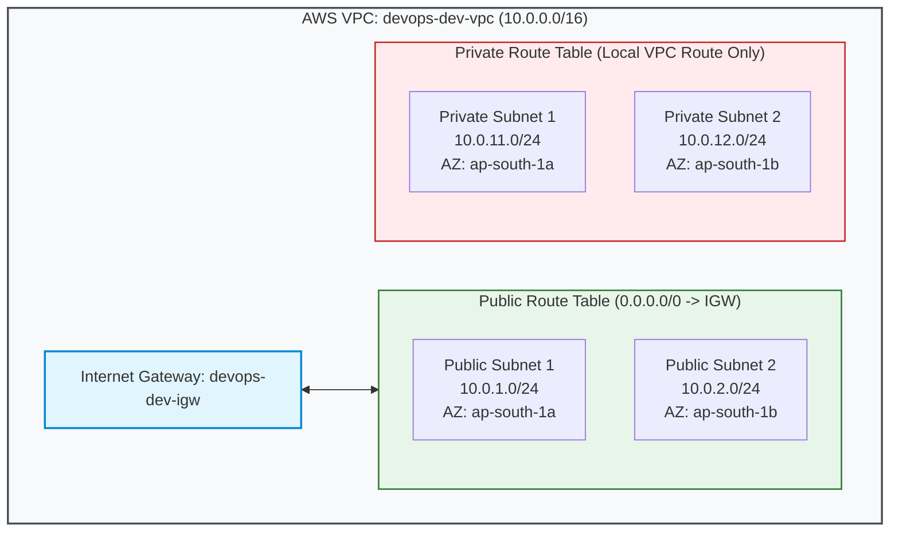

# 🌐 Production-Grade AWS VPC Creation using Terraform
### Phase 2: Terraform Project Structure — End-to-End Hands-on (5+ Years DevOps Interview Standard)

Welcome to the **VPC Creation using Terraform** practical lab! In this hands-on project, you will design, architect, and deploy an enterprise-grade AWS Virtual Private Cloud (VPC) spanning multiple Availability Zones with Public and Private subnets, Route Tables, and an Internet Gateway using modular, production-ready Terraform code.

---

## 📑 Table of Contents
1. [Project Overview & Architecture Requirements](#1-project-overview--architecture-requirements)
2. [Project Folder Structure](#2-project-folder-structure)
3. [File-by-File Implementation & Deep Dive](#3-file-by-file-implementation--deep-dive)
   - [3.1 versions.tf – Core Engine & Provider Constraints](#31-versionstf--core-engine--provider-constraints)
   - [3.2 providers.tf – AWS Provider Configuration](#32-providerstf--aws-provider-configuration)
   - [3.3 variables.tf – Comprehensive Data Types & Validations](#33-variablestf--comprehensive-data-types--validations)
   - [3.4 terraform.tfvars – Environment Configuration Values](#34-terraformtfvars--environment-configuration-values)
   - [3.5 locals.tf – Reusable Constants & Tag Merging](#35-localstf--reusable-constants--tag-merging)
   - [3.6 main.tf – Core Infrastructure Resources](#36-maintf--core-infrastructure-resources)
   - [3.7 outputs.tf – Splat Expressions & Resource Exporting](#37-outputstf--splat-expressions--resource-exporting)
   - [3.8 .gitignore – Security Exclusions & State Protection](#38-gitignore--security-exclusions--state-protection)
4. [Step-by-Step Execution Lifecycle](#4-step-by-step-execution-lifecycle)
5. [Key DevOps Interview Concepts & Questions](#5-key-devops-interview-concepts--questions)
6. [Hands-on Assignment Checklist](#6-hands-on-assignment-checklist)

---

## 1. Project Overview & Architecture Requirements

### 🏢 Real-World Company Scenario
Assume you are working as a **Senior DevOps Engineer**. Your organization requires a highly available, secure, and isolated network infrastructure in the **AWS Mumbai region (`ap-south-1`)**.

### 📐 Architecture Diagram


> [!NOTE]
> **Conceptual Note**: Private subnets have no NAT Gateway in this baseline lab, meaning instances placed inside them cannot initiate outbound internet traffic. In production, an AWS NAT Gateway or NAT instance would be placed in the public subnet to route private outbound traffic.

### 📊 Planned Resources Summary
| Resource Type | Resource Name | Quantity | Purpose |
| :--- | :--- | :---: | :--- |
| `aws_vpc` | `main` | 1 | Base virtual private network (`10.0.0.0/16`) |
| `aws_internet_gateway` | `igw` | 1 | Enables inbound and outbound public internet communication |
| `aws_subnet` | `public` | 2 | Web / Load Balancer tier across two Availability Zones |
| `aws_subnet` | `private` | 2 | Application / Database tier across two Availability Zones |
| `aws_route_table` | `public` | 1 | Route table directing internet-bound traffic to the IGW |
| `aws_route_table` | `private` | 1 | Route table strictly for internal VPC local traffic |
| `aws_route` | `public_internet` | 1 | Default route entry (`0.0.0.0/0` -> Internet Gateway) |
| `aws_route_table_association` | `public` & `private` | 4 | Explicitly associates subnets with their respective route tables |

> [!IMPORTANT]
> **Key Architecture Rule**: A subnet is **NOT** genuinely public simply because `map_public_ip_on_launch = true`. It is truly public only if its associated Route Table contains an active route (`0.0.0.0/0`) pointing to an Internet Gateway (`aws_internet_gateway`).

---

## 2. Project Folder Structure

This project follows an industry-standard, decoupled file architecture separating settings, inputs, computed values, resources, and outputs:

```text
terraform-vpc-project/
├── .gitignore               # Excludes local state files, secrets, and caches
├── versions.tf              # Locks Terraform CLI and AWS provider versions
├── providers.tf             # AWS provider configuration and regional setup
├── variables.tf             # Input variable declarations with types and validations
├── terraform.tfvars         # Concrete environment values
├── locals.tf                # Computed naming prefixes and standardized tag maps
├── main.tf                  # AWS resource definitions (VPC, Subnets, Gateways, Routes)
├── outputs.tf               # Exported attributes (VPC ID, Subnet IDs, RT IDs)
└── .terraform.lock.hcl      # Automatically generated provider dependency lock file
```

---

## 3. File-by-File Implementation & Deep Dive

---

### 3.1 `versions.tf` – Core Engine & Provider Constraints

**Purpose**: Enforces minimum compatibility requirements for the Terraform CLI binary and provider plugins.

```hcl
terraform {
  required_version = ">= 1.5.0"

  required_providers {
    aws = {
      source  = "hashicorp/aws"
      version = ">= 5.0, < 7.0"
    }
  }
}
```

#### 🔍 Explanation:
- `terraform`: The root settings block for Terraform engine configuration.
- `required_version`: Specifies the minimum allowed Terraform CLI version (`>= 1.5.0`).
- `required_providers`: Declares the required external plugin dependencies.
- `source`: The registry namespace where the provider is fetched (`hashicorp/aws` from the official HashiCorp Registry).
- `version`: Version constraint allowing minor updates while preventing breaking major version changes.

> [!TIP]
> **DevOps Interview Takeaway**: Running `terraform init` generates the `.terraform.lock.hcl` file. It records the exact resolved provider version and cryptographic hashes (checksums). **Always commit `.terraform.lock.hcl` to Git** to guarantee reproducible builds across your team and CI/CD pipelines.

---

### 3.2 `providers.tf` – AWS Provider Configuration

**Purpose**: Specifies which cloud provider Terraform communicates with and sets default regional parameters.

```hcl
provider "aws" {
  region = var.aws_region
}
```

#### 🔍 Explanation:
- Never hardcode cloud access keys or secret keys in this file.
- Authentication is resolved dynamically using the local AWS CLI profile (`aws configure`), environment variables (`AWS_ACCESS_KEY_ID`), or IAM Instance Profiles / OIDC roles in automated CI/CD pipelines.
- The region is parameterized using `var.aws_region`.

---

### 3.3 `variables.tf` – Comprehensive Data Types & Validations

**Purpose**: Defines all input parameters accepted by this infrastructure module.

#### 📘 Terraform Data Types Quick Reference:
| Data Type | Syntax | Example | Description |
| :--- | :--- | :--- | :--- |
| **String** | `string` | `"devops"` | Single alphanumeric text sequence |
| **Number** | `number` | `2` | Integer or floating point number |
| **Boolean** | `bool` | `true` | Logical true or false flag |
| **List** | `list(string)` | `["a", "b"]` | Ordered array of elements (indexed from 0) |
| **Set** | `set(string)` | `toset(["a", "b"])` | Unique collection of values with no duplicates |
| **Map** | `map(string)` | `{ env = "dev" }` | Key-value dictionary |
| **Object** | `object({...})` | `{ name=string, id=number }` | Complex heterogeneous schema |
| **Tuple** | `tuple([...])` | `["dev", 2, true]` | Fixed-length sequence with distinct types per index |

---

#### 📄 Complete `variables.tf` Code
```hcl
# ==============================================================================
# 1. String Variables
# ==============================================================================

variable "aws_region" {
  description = "AWS deployment region"
  type        = string
}

variable "project_name" {
  description = "Project name prefix"
  type        = string
}

variable "environment" {
  description = "Target deployment environment"
  type        = string

  validation {
    condition     = contains(["dev", "qa", "prod"], var.environment)
    error_message = "Environment must be one of: dev, qa, or prod."
  }
}

variable "vpc_cidr" {
  description = "CIDR block for the VPC"
  type        = string
}

# ==============================================================================
# 2. Boolean Variables
# ==============================================================================

variable "enable_dns_support" {
  description = "Enable DNS resolution support inside the VPC"
  type        = bool
}

variable "enable_dns_hostnames" {
  description = "Enable DNS hostnames assignment for instances inside the VPC"
  type        = bool
}

# ==============================================================================
# 3. List Variables
# ==============================================================================

variable "availability_zones" {
  description = "List of AWS Availability Zones"
  type        = list(string)
}

variable "public_subnet_cidrs" {
  description = "List of CIDR blocks for Public Subnets"
  type        = list(string)

  validation {
    condition     = length(var.public_subnet_cidrs) == length(var.availability_zones)
    error_message = "The number of public subnet CIDRs must match the number of specified availability zones."
  }
}

variable "private_subnet_cidrs" {
  description = "List of CIDR blocks for Private Subnets"
  type        = list(string)

  validation {
    condition     = length(var.private_subnet_cidrs) == length(var.availability_zones)
    error_message = "The number of private subnet CIDRs must match the number of specified availability zones."
  }
}

# ==============================================================================
# 4. Map Variable
# ==============================================================================

variable "common_tags" {
  description = "Standard resource tags map"
  type        = map(string)
}
```

---

### 3.4 `terraform.tfvars` – Environment Configuration Values

**Purpose**: Supplies concrete, environment-specific values for the variables declared in `variables.tf`. Terraform automatically detects and loads `terraform.tfvars`.

```hcl
# String Values
aws_region   = "ap-south-1"
project_name = "devops"
environment  = "dev"
vpc_cidr     = "10.0.0.0/16"

# Boolean Values
enable_dns_support   = true
enable_dns_hostnames = true

# List Values (2 Availability Zones in Mumbai)
availability_zones = [
  "ap-south-1a",
  "ap-south-1b"
]

public_subnet_cidrs = [
  "10.0.1.0/24",
  "10.0.2.0/24"
]

private_subnet_cidrs = [
  "10.0.11.0/24",
  "10.0.12.0/24"
]

# Map Values
common_tags = {
  Project     = "DevOps"
  Environment = "Dev"
  Owner       = "DevOps-Team"
  ManagedBy   = "Terraform"
}
```

---

### 3.5 `locals.tf` – Reusable Constants & Tag Merging

**Purpose**: Computes local intermediate values and standardizes naming conventions. Unlike input variables, locals cannot be directly overridden by external callers.

```hcl
locals {
  # Prefix: "devops-dev"
  resource_prefix = "${var.project_name}-${var.environment}"

  # VPC Name: "devops-dev-vpc"
  vpc_name = "${local.resource_prefix}-vpc"

  # Merge variable tags with mandatory standard operational tags
  common_tags = merge(
    var.common_tags,
    {
      Project     = var.project_name
      Environment = var.environment
      ManagedBy   = "Terraform"
    }
  )
}
```

> [!NOTE]
> **Key Distinction**:
> - **Variables**: External inputs passed into the configuration.
> - **Locals**: Internal computed expressions and constants used to keep code DRY (Don't Repeat Yourself).

---

### 3.6 `main.tf` – Core Infrastructure Resources

**Purpose**: Declares the primary infrastructure components and establishes explicit and implicit dependencies.

```hcl
# ==============================================================================
# 1. AWS VPC
# ==============================================================================
resource "aws_vpc" "main" {
  cidr_block           = var.vpc_cidr
  enable_dns_support   = var.enable_dns_support
  enable_dns_hostnames = var.enable_dns_hostnames

  tags = merge(
    local.common_tags,
    {
      Name = local.vpc_name
    }
  )
}

# ==============================================================================
# 2. Internet Gateway
# ==============================================================================
resource "aws_internet_gateway" "igw" {
  vpc_id = aws_vpc.main.id

  tags = merge(
    local.common_tags,
    {
      Name = "${local.resource_prefix}-igw"
    }
  )
}

# ==============================================================================
# 3. Public Subnets (Iterated via count & count.index)
# ==============================================================================
resource "aws_subnet" "public" {
  count                   = length(var.public_subnet_cidrs)
  vpc_id                  = aws_vpc.main.id
  cidr_block              = var.public_subnet_cidrs[count.index]
  availability_zone       = var.availability_zones[count.index]
  map_public_ip_on_launch = true

  tags = merge(
    local.common_tags,
    {
      Name = "${local.resource_prefix}-public-${count.index + 1}"
      Tier = "Public"
    }
  )
}

# ==============================================================================
# 4. Private Subnets
# ==============================================================================
resource "aws_subnet" "private" {
  count                   = length(var.private_subnet_cidrs)
  vpc_id                  = aws_vpc.main.id
  cidr_block              = var.private_subnet_cidrs[count.index]
  availability_zone       = var.availability_zones[count.index]
  map_public_ip_on_launch = false

  tags = merge(
    local.common_tags,
    {
      Name = "${local.resource_prefix}-private-${count.index + 1}"
      Tier = "Private"
    }
  )
}

# ==============================================================================
# 5. Public Route Table
# ==============================================================================
resource "aws_route_table" "public" {
  vpc_id = aws_vpc.main.id

  tags = merge(
    local.common_tags,
    {
      Name = "${local.resource_prefix}-public-rt"
    }
  )
}

# ==============================================================================
# 6. Public Internet Route (0.0.0.0/0 -> IGW)
# ==============================================================================
resource "aws_route" "public_internet" {
  route_table_id         = aws_route_table.public.id
  destination_cidr_block = "0.0.0.0/0"
  gateway_id             = aws_internet_gateway.igw.id
}

# ==============================================================================
# 7. Associate Public Subnets with Public Route Table
# ==============================================================================
resource "aws_route_table_association" "public" {
  count          = length(aws_subnet.public)
  subnet_id      = aws_subnet.public[count.index].id
  route_table_id = aws_route_table.public.id
}

# ==============================================================================
# 8. Private Route Table
# ==============================================================================
resource "aws_route_table" "private" {
  vpc_id = aws_vpc.main.id

  tags = merge(
    local.common_tags,
    {
      Name = "${local.resource_prefix}-private-rt"
    }
  )
}

# ==============================================================================
# 9. Associate Private Subnets with Private Route Table
# ==============================================================================
resource "aws_route_table_association" "private" {
  count          = length(aws_subnet.private)
  subnet_id      = aws_subnet.private[count.index].id
  route_table_id = aws_route_table.private.id
}
```

---

### 3.7 `outputs.tf` – Splat Expressions & Resource Exporting

**Purpose**: Surfaces critical resource attributes in stdout upon execution and facilitates module composition. Uses **Splat Expressions (`[*]`)** to extract IDs from list resources created with `count`.

```hcl
output "vpc_id" {
  description = "Unique ID of the provisioned VPC"
  value       = aws_vpc.main.id
}

output "vpc_cidr" {
  description = "CIDR block of the provisioned VPC"
  value       = aws_vpc.main.cidr_block
}

output "internet_gateway_id" {
  description = "ID of the attached Internet Gateway"
  value       = aws_internet_gateway.igw.id
}

output "public_subnet_ids" {
  description = "List of Public Subnet IDs"
  value       = aws_subnet.public[*].id
}

output "private_subnet_ids" {
  description = "List of Private Subnet IDs"
  value       = aws_subnet.private[*].id
}

output "public_route_table_id" {
  description = "ID of the Public Route Table"
  value       = aws_route_table.public.id
}

output "private_route_table_id" {
  description = "ID of the Private Route Table"
  value       = aws_route_table.private.id
}
```

---

### 3.8 `.gitignore` – Security Exclusions & State Protection

**Purpose**: Prevents sensitive credentials, state files, and bulky provider plugins from being accidentally pushed to Git.

```gitignore
# Terraform working directory
.terraform/

# Terraform state files (Never commit plaintext state)
*.tfstate
*.tfstate.*

# Variable files containing secret parameters
*.tfvars
!*.tfvars.example

# Execution plan binary files
*.tfplan

# Crash log files
crash.log

# Local override files
override.tf
override.tf.json
*_override.tf
*_override.tf.json
```

---

## 4. Step-by-Step Execution Lifecycle

Execute the following end-to-end command sequence:

```mermaid
flowchart LR
    A["1. aws configure"] --> B["2. terraform fmt"]
    B --> C["3. terraform init"]
    C --> D["4. terraform validate"]
    D --> E["5. terraform plan -out=tfplan"]
    E --> F["6. terraform apply tfplan"]
    F --> G["7. aws cli / console verify"]
    G --> H["8. terraform destroy"]

    style A fill:#e3f2fd,stroke:#1565c0,color:#000
    style C fill:#fff3e0,stroke:#e65100,color:#000
    style D fill:#f3e5f5,stroke:#4a148c,color:#000
    style E fill:#e8f5e9,stroke:#1b5e20,color:#000
    style F fill:#e0f2f1,stroke:#004d40,color:#000
    style H fill:#ffebee,stroke:#b71c1c,color:#000
```



### Step 1: AWS CLI Authentication
```powershell
aws configure --profile dev
$env:AWS_PROFILE = "dev"
aws sts get-caller-identity
```

### Step 2: Format All Configuration Files
```powershell
terraform fmt -recursive
```
*Ensures uniform HCL formatting and tab indentation.*

### Step 3: Initialize the Project
```powershell
terraform init
```
*Discovers and downloads the AWS provider plugin into `.terraform/` and generates `.terraform.lock.hcl`.*

### Step 4: Validate Syntax & Resource Consistency
```powershell
terraform validate
```
*Output: `Success! The configuration is valid.`*

### Step 5: Generate and Persist the Execution Plan
```powershell
terraform plan -out=tfplan
```
*Expected Output: `Plan: 12 to add, 0 to change, 0 to destroy.`*

### Step 6: Apply the Persisted Plan
```powershell
terraform apply tfplan
```
*Provisions all 12 AWS resources deterministically using the exact reviewed execution graph.*

### Step 7: Inspect Outputs
```powershell
terraform output
```

### Step 8: Verify via AWS CLI
```powershell
# Verify VPC
aws ec2 describe-vpcs --filters "Name=tag:Name,Values=devops-dev-vpc"

# Verify Subnets
aws ec2 describe-subnets --filters "Name=vpc-id,Values=<YOUR_VPC_ID>"

# Verify Route Tables
aws ec2 describe-route-tables --filters "Name=vpc-id,Values=<YOUR_VPC_ID>"
```

### Step 9: Teardown Infrastructure (Clean Up)
```powershell
terraform destroy -auto-approve
```

---

## 5. Key DevOps Interview Concepts & Questions

### 🎯 5+ Years Senior DevOps Interview Topics:

1. **Implicit vs. Explicit Dependencies**:
   - `aws_internet_gateway.igw` references `aws_vpc.main.id`. Terraform automatically analyzes the resource graph and creates the VPC before the IGW. This is an **implicit dependency**.
   - Explicit dependencies are declared manually using `depends_on = [aws_vpc.main]` when Terraform cannot automatically detect the relationship from attribute references.

2. **`count` vs. `for_each`**:
   - `count` uses numeric indexing (`0, 1, 2...`). If an item from the middle of a list is removed, Terraform may destroy and recreate subsequent resources.
   - `for_each` binds each resource to a persistent key (string or map key), making it safer for managing independent resources like subnets in production.

3. **What defines a "Public Subnet"?**:
   - A subnet is public **only** if:
     1. Its associated route table has a default route (`0.0.0.0/0`) targeting an **Internet Gateway**.
     2. Instances launched inside it can receive public IPv4 addresses (`map_public_ip_on_launch = true`).

4. **Why `.terraform.lock.hcl` must be committed to Git**:
   - It guarantees that all developers and CI/CD runners download the exact same provider binary version with identical cryptographic checksums, eliminating "works on my machine" issues.

---

## 6. Hands-on Assignment Checklist

Track your completion step-by-step:

- [ ] **Step 1**: Create project directory `terraform-vpc-project`
- [ ] **Step 2**: Create all 8 project files (`main.tf`, `variables.tf`, etc.)
- [ ] **Step 3**: Configure `versions.tf` with Terraform CLI and AWS Provider constraints
- [ ] **Step 4**: Configure `providers.tf` with regional parameterization
- [ ] **Step 5**: Declare variables in `variables.tf` with type constraints and validations
- [ ] **Step 6**: Populate `terraform.tfvars` with Mumbai region (`ap-south-1`) values
- [ ] **Step 7**: Configure `locals.tf` using the `merge()` function
- [ ] **Step 8**: Write all 9 AWS resource blocks in `main.tf`
- [ ] **Step 9**: Define outputs in `outputs.tf` using splat expressions (`[*]`)
- [ ] **Step 10**: Set up exclusion patterns in `.gitignore`
- [ ] **Step 11**: Run `terraform fmt`, `terraform init`, and `terraform validate`
- [ ] **Step 12**: Run `terraform plan` (Verify 12 to add) and execute `terraform apply`

---

**Happy Terraforming! 🚀**
